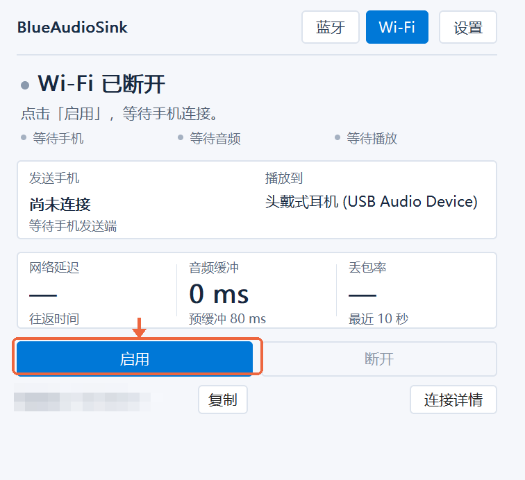
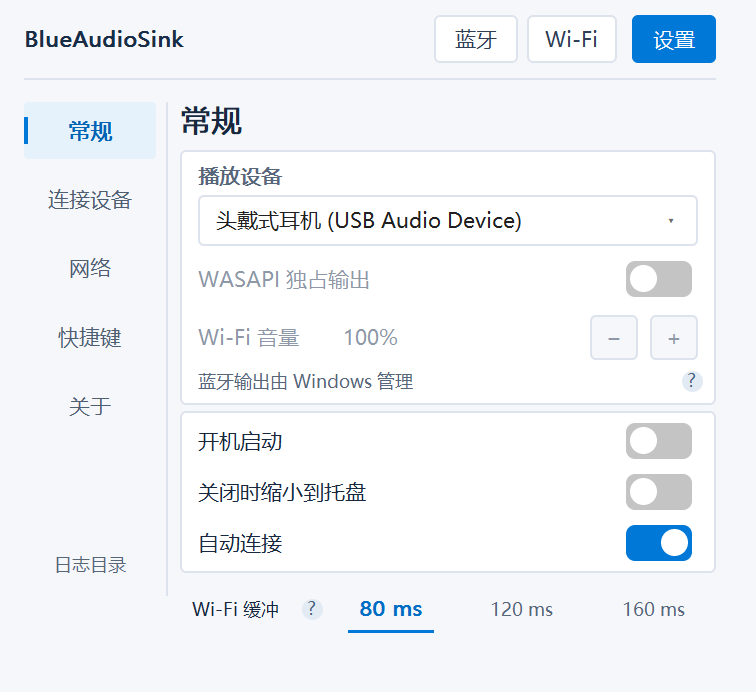
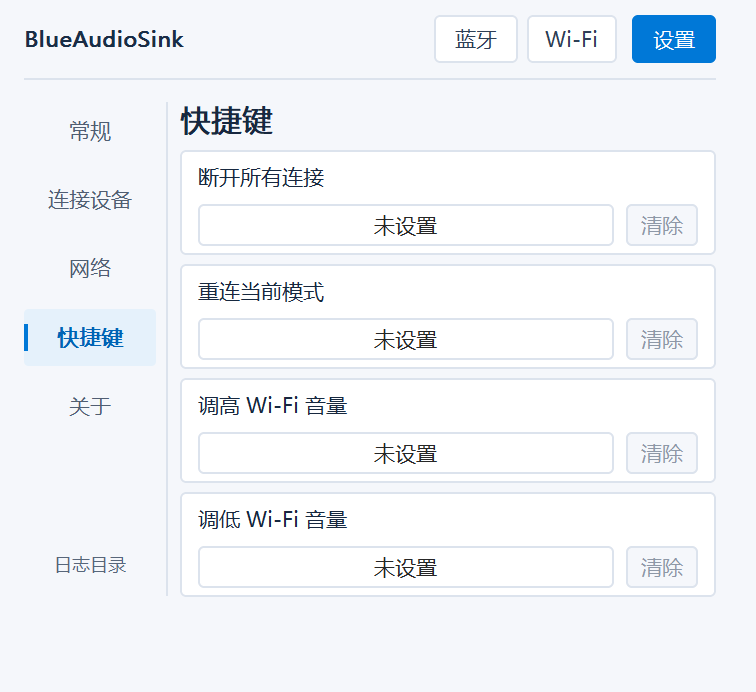
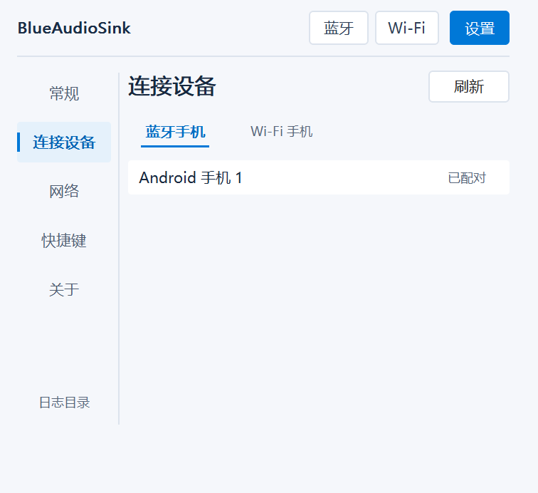
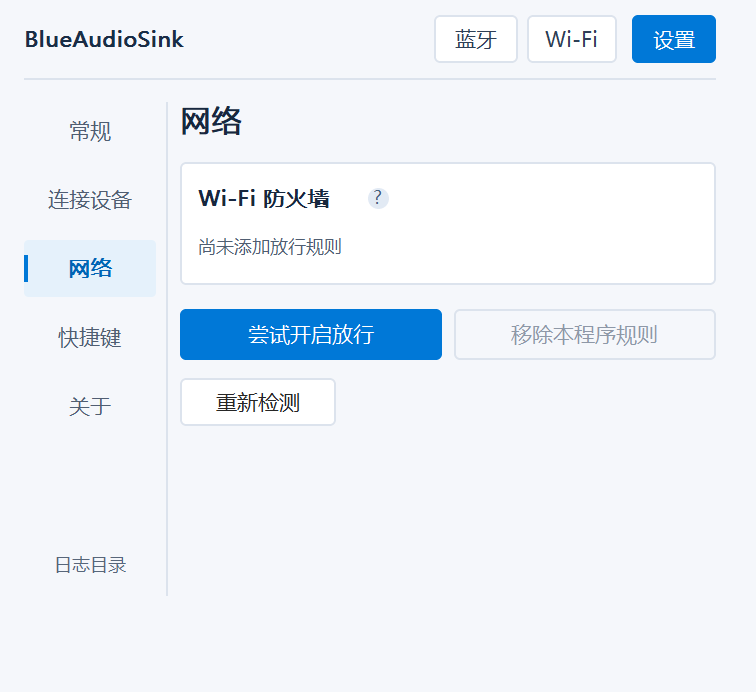
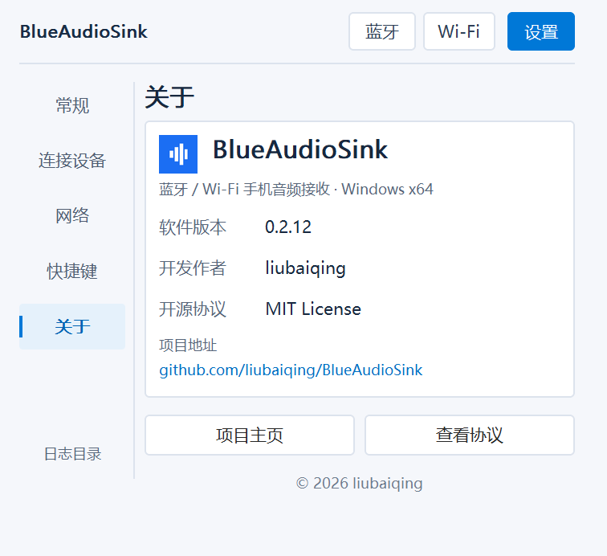

<p align="center"></p>
<h1 align="center">BlueAudioSink</h1>
<p align="center">Chinese name: 蓝音频 · Abbreviation: BAS</p>
<p align="center">Your phone's audio. Your PC's speakers.<br/>A lightweight Windows receiver with Bluetooth and local-network Wi-Fi modes.</p>
<p align="center"><a href="https://github.com/liubaiqing/BlueAudioSink/releases/tag/v0.3.1">Download latest</a> · English | <a href="README.zh-CN.md">简体中文</a> · <a href="LICENSE">MIT License</a></p>

**Latest stable release: Windows 0.3.1 / Android 0.3.1 (BAS2).** Update both apps together; Wi-Fi is incompatible with 0.2.x. Wi-Fi uses Android’s standard audio-capture consent; no Shizuku, root, developer options or ADB is required

**Changes since 0.2.16:** verified control and audio paths, automatic UDP/TCP transport selection, improved network-change recovery, more responsive desktop controls and Android volume dragging. Buffer presets apply during sending; refresh keeps the device list. [Release notes](https://github.com/liubaiqing/BlueAudioSink/releases/tag/v0.3.1)

Developed by **liubaiqing**. The apps currently use a Chinese interface; the guides below show which controls to use. The device screenshots are from real devices; settings layout previews are rendered by the application drawing code with example devices. Device names, local addresses, and phone status information are masked.

## A look at both apps

| Windows receiver | Android Wi-Fi sender |
| :---: | :---: |
|  |  |

**Bluetooth** needs no Android sender. **Wi-Fi** uses the companion Android app. Wi-Fi output is selected in app Settings. Bluetooth output is managed by Windows.

## Download and open

| Device | Download | Requirements |
| --- | --- | --- |
| PC | [BlueAudioSink-0.3.1.exe](https://github.com/liubaiqing/BlueAudioSink/releases/download/v0.3.1/BlueAudioSink-0.3.1.exe) | Windows 10 2004+ / Windows 11, x64 |
| Phone — Wi-Fi only | [BlueAudioSink-Sender-0.3.1.apk](https://github.com/liubaiqing/BlueAudioSink/releases/download/v0.3.1/BlueAudioSink-Sender-0.3.1.apk) | Android 10+ |

Double-click the EXE; no .NET installation is needed. Open the APK on your phone and install it. Android may ask you to allow installation from the app used to open the download. The APK is a Release build signed with a dedicated key. [SHA-256 checksums](https://github.com/liubaiqing/BlueAudioSink/releases/download/v0.3.1/SHA256SUMS.txt) are available.

<details>
<summary>Already installed the old debug-signed Android APK?</summary>

Uninstall it before installing the release-signed APK. Uninstalling clears saved devices and app data. Future releases will keep the release key for in-place updates.

</details>

## Wi-Fi: three steps to listen

**First:** connect both devices to the same router. The PC can use Ethernet. **No USB, developer options, or wireless debugging is required.**

### 1. On the PC, select Wi-Fi

If the Wi-Fi page says disconnected, click **启用** (Enable) to wait for the phone. Keep the PC app open, then start sending from the phone.


### 2. On the phone, select the PC and start sending

Tap the PC → tap **开始发送** (Start sending) → approve Android's recording and capture prompts → play music or a video. Once started, the button becomes **停止发送** (Stop sending), as shown below.


**PC missing?** Tap **刷新** (Refresh). Still missing? Tap **手动添加** (Manual add) and enter the PC address shown in the Windows app. Keep the default port unless you changed it.

### 3. Check the PC and choose your speakers

The phone should show **发送中** (Sending). On the PC, **正在播放手机音频** means audio is being sent to the playback device; **已连接，当前静音** means connected but the incoming audio is silent. Play audio before judging the connection.

Open **设置 → 常规** (Settings → General) in the left sidebar to select the Wi-Fi headphones or speakers without changing the Windows default output. Bluetooth routing can be adjusted in the Windows volume mixer. Hover over controls for explanations; keyboard users can press F1 after focusing a control.

The PC remembers the last Bluetooth or Wi-Fi mode automatically. **Settings → General → 自动连接** applies to both: enabling it starts the selected PC connection on launch or mode switch; disabling it restores the page for manual connection. Phone capture still requires consent and Start sending. **Settings → 关于** shows the version, author, project and MIT license links.



On the PC Wi-Fi page, **启用** starts discovery and reception; **断开** stops discovery, all TCP/UDP channels and audio playback. Reconnecting only restores the PC connection: if the phone is no longer sending, tap **开始发送** on the phone

## Global shortcuts

Open **Settings → 快捷键** to bind disconnect-all, reconnect-current-mode, Wi-Fi volume up and down. All start unbound. Click an entry and press a Ctrl/Alt combination, optionally with Shift; press Esc to cancel or Delete to clear. A conflict asks you to choose another combination; no replacement is chosen automatically. Shortcuts work in the background and tray. Volume changes by 5%; reconnecting Wi-Fi cannot start phone capture without the phone’s normal consent



## Optional WASAPI exclusive output

In **Settings → General**, Wi-Fi users can enable **WASAPI 独占输出**. It is off by default and unavailable in Bluetooth mode. Other apps may be unable to play through the same device or switch outputs automatically while exclusive output is active. If they remain silent after you turn it off, reselect the original output device in those apps

Enabling it first sets **Wi-Fi 音量** to **0%**. Raise it using the + button; this software volume works in shared and exclusive modes. Windows app-mixer volume does not control exclusive playback. The status beneath shows the actual output mode; hover for a fallback reason if exclusive output is unavailable

Exclusive output uses device events with a 100 ms device block and at least 220 ms startup prefill for stable delivery. This adds latency; shared output remains the default

Click the PC Wi-Fi volume percentage to enter an integer from 0 to 100. Once connected, the Android **电脑接收音量** slider below the buffer presets remotely controls this same Wi-Fi volume. Both apps must be updated; it reads the PC value on connection and stays disabled until synchronized. It does not change phone or PC master volume

## Bluetooth: pair → select → connect

1. Pair your phone in **Windows system Bluetooth settings**.
2. In BlueAudioSink, open **设置 → 连接设备 → 蓝牙手机** and select the phone. Bluetooth output is managed by the Windows volume mixer.
3. Select **蓝牙 → 连接**. Play audio on the phone; choose the PC as its Bluetooth media output if needed.


No Android sender is needed. Adapter and driver support is required. Auto-connect attempts to connect to the preferred phone; the phone must still send audio.

## Reconnect to a remembered PC

Enable display over other apps once under **设置 → 音量悬浮窗** (Settings → Volume overlay). While sending, tap the sender notification to show the PC volume slider. Close the notification shade if it stays open

On Android, the top-right gear opens **Device info** and **About**, including the installed version, author, project and MIT license. The main screen shows elapsed sending time instead of a packet count; it pauses during address recovery and resets when a new sending session starts

Connect once by discovery or manual address, then tap the remembered PC to find its current address after changing networks. Multiple addresses for the same identity share one record. Legacy address entries require initial confirmation; after connecting, **合并旧地址记录** lets you explicitly merge other old addresses belonging to that PC. Matching names alone never merge computers

Audio is blocked until identity verification and connection complete. The PC must have Wi-Fi reception enabled and LAN traffic must be permitted; identity does not bypass firewalls or provide cryptographic pairing

## Appearance, speaker protection and logs

Both apps offer System, Light and Dark themes under Settings. On Windows, open **General**.

The Android sender mutes the phone’s media volume when Wi-Fi connects. **防误开外放** (Prevent accidental speaker playback) optionally uses Android Accessibility to intercept the physical volume-up key during transmission. The PC receiver volume is independent.

Windows **Settings → Connection logs** manages retention and the log folder. Android diagnostics sync to the Windows log after a connection is confirmed. If the first connection fails, use **Settings → Export connection logs** on Android. Review Windows logs for device names and addresses before sharing publicly.

## Switch phones

Open **设置 → 连接设备** (Settings → Devices), browse either list without interrupting playback. To connect a phone, use the list for the active mode. A Wi-Fi phone must first select the PC in its sender app and start sending. One source plays at a time.



## No sound? Check these first

| What you see | What to do |
| --- | --- |
| Phone cannot find the PC | Select Wi-Fi and click Enable on the PC. Check the same router; try Refresh or Manual add. Guest networks may isolate devices. |
| Connected, currently silent | Play audio, check volumes, then try another source app. Some apps or protected content block playback capture. |
| Audio received but cannot be heard | Select the correct headphones/speakers in Settings → General. |
| Audio stutters | Prefer 5 GHz Wi-Fi. Increase buffering one step; this adds latency. |
| Wi-Fi still cannot receive | Try the optional firewall helper below. |

### Firewall helper — only if Wi-Fi reception fails

If audio works, **skip this**. Otherwise open **设置 → 网络** (Settings → Network) → **尝试开启放行**, then approve the Windows administrator prompt. This only adds rules for this EXE, private networks, and local-subnet sources. You can remove its rules on the same page.



Moving the EXE requires configuring the rule again. Public networks, organization policies, third-party firewalls, or router isolation can still block reception.

Wi-Fi uses unencrypted local TCP/UDP; use a trusted network. Closing the PC window exits by default; enabling Close to tray keeps it running. Opening Settings keeps audio running. Mixing multiple phones simultaneously is not supported.

## Build from source

### Windows

Use Windows with the .NET 8 SDK or a compatible newer SDK.

```powershell
dotnet build .\BlueAudioSink.sln -c Debug -p:Platform=x64
dotnet publish .\src\SinkLite\SinkLite.csproj -c Release -p:Platform=x64
```

Output: `src/SinkLite/bin/x64/Release/net8.0-windows10.0.19041.0/win-x64/publish/BlueAudioSink.exe`.

To keep the executable small, the project uses `OutputType=Exe` and `NAudio.Wasapi`. A post-publish step uses Visual Studio's `editbin` to set the Windows subsystem and hide the console. Override the tool path for your MSVC installation:

```powershell
dotnet publish .\src\SinkLite\SinkLite.csproj -c Release -p:Platform=x64 '-p:EditBinPath=C:\path\to\editbin.exe'
```

If `editbin` is unavailable, publishing continues, but the app may open a console window.

### Android

Use JDK 21 and Android SDK 35. The repository includes the Gradle Wrapper.

```powershell
cd android
# Set ANDROID_HOME, or configure sdk.dir in your local.properties file.
.\gradlew.bat assembleDebug
```

Debug output: `android/app/build/outputs/apk/debug/app-debug.apk`.

For a signed Release build, copy `android/signing.properties.example` to `android/signing.properties`, fill in your own keystore path and credentials, then run:

```powershell
.\gradlew.bat assembleRelease
```

Signed output: `android/app/build/outputs/apk/release/app-release.apk`. Without local signing configuration, Gradle produces an unsigned Release APK. Keystores, passwords, and local SDK settings must stay out of Git. Back up your release key and credentials: subsequent app updates must use the same signing identity. Forks should use their own key.

## Validation and diagnostics

```powershell
dotnet run --project tools/AudioRegression/AudioRegression.csproj -c Release
dotnet run --project tools/FirewallRegression/FirewallRegression.csproj -c Release

.\BlueAudioSink.exe --list
.\BlueAudioSink.exe --connect
.\BlueAudioSink.exe --diagnose 30
.\BlueAudioSink.exe --help

dotnet run --project tools/SinkProbe -- endpoints
dotnet run --project tools/SinkProbe -- meter 10
```

Settings: `%LocalAppData%\BlueAudioSink\settings.ini`. Logs default to the `logs` folder beside the EXE; change the folder and retention period in Settings → Connection logs.

## Repository layout

- `src/SinkLite/`: Windows receiver, Win32 / GDI UI, Bluetooth, Wi-Fi, and WASAPI playback.
- `android/`: Android sender with Jetpack Compose and system playback capture.
- `tools/`: regression checks, diagnostics, and asset tools.
- `docs/`: current architecture, protocol, implementation specifications, and acceptance criteria, primarily in Chinese.

See the [development documentation](docs/00-overview.md) for the current architecture, protocol, desktop/Android implementation, acceptance criteria, and development direction.

Enable **Settings → General → Close to tray** to keep audio running after closing the window. The tray icon reflects connection status; right-click to open the window or fully exit. This option is off by default.

## About

Open **Settings → 关于** for the current version, author **liubaiqing**, project homepage and MIT license links



## License

[MIT](LICENSE). Third-party dependencies and tools retain their respective licenses.
