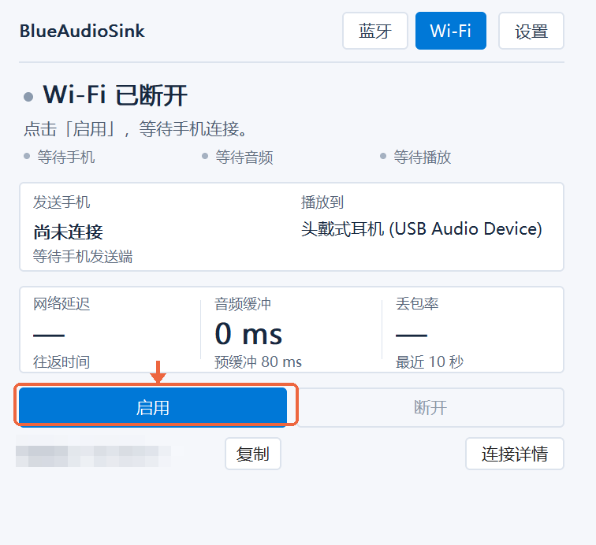
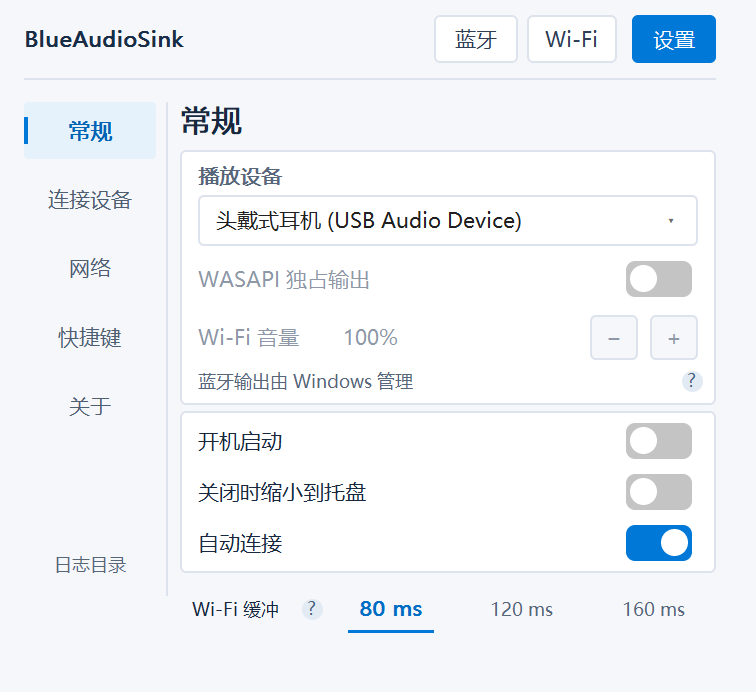
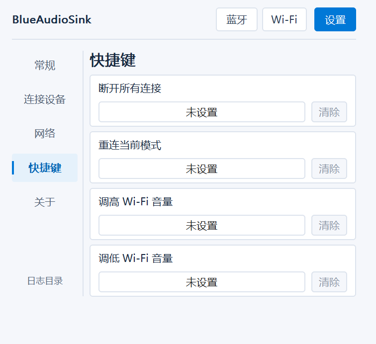
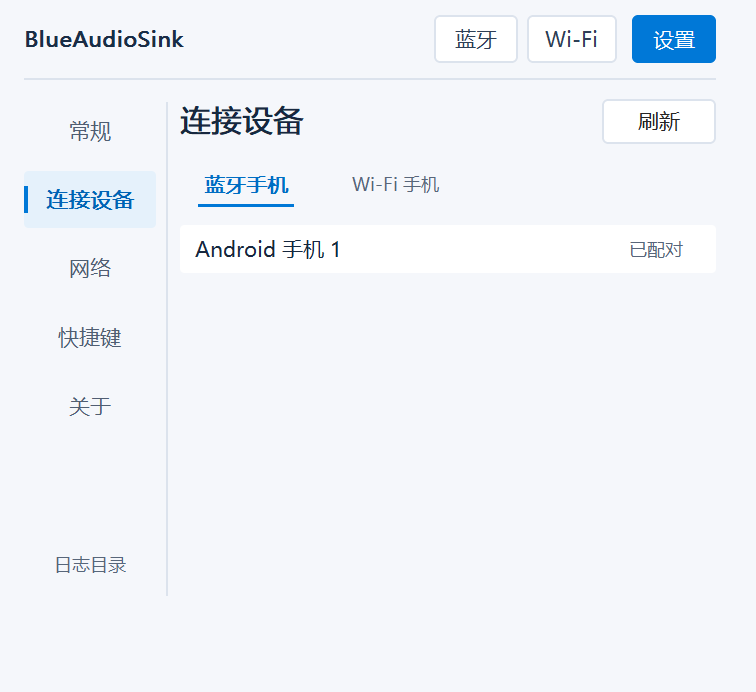
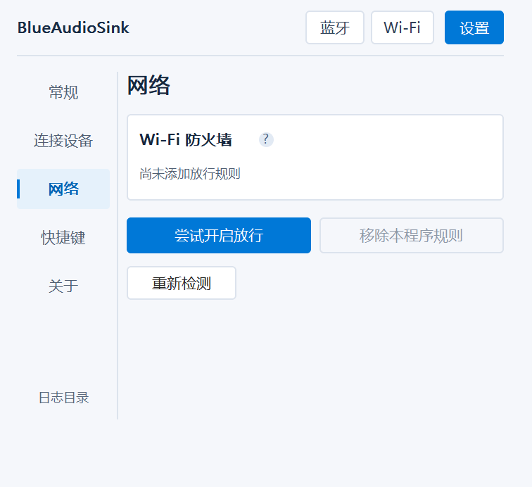
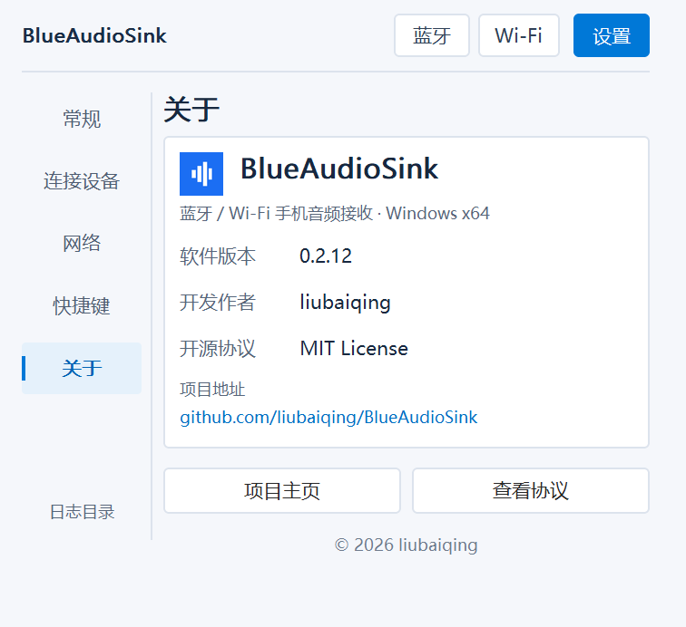

<p align="center"></p>
<h1 align="center">蓝音频 · BlueAudioSink</h1>
<p align="center">英文全称 BlueAudioSink · 简称 BAS</p>
<p align="center">手机的声音，用电脑的耳机或音箱播放。<br/>轻量 Windows 接收端，支持蓝牙与局域网 Wi-Fi。</p>
**最新正式版：电脑 0.3.1 / Android 0.3.1（BAS2）**，必须双端一起升级，Wi-Fi 不与 0.2.x 混用。Wi-Fi 使用 Android 系统音频捕获授权，无需 Shizuku、root、开发者选项或 ADB

<p align="center"><a href="https://github.com/liubaiqing/BlueAudioSink/releases/tag/v0.3.1">下载最新版</a> · <a href="README.md">English</a> | 简体中文 · <a href="LICENSE">MIT 开源</a></p>

**相较 0.2.16：**重构连接与音频路径验证，自动选择 UDP/TCP 传输，改进换网恢复；优化电脑控件响应和手机音量拖动，缓冲档位发送中生效，刷新保留设备列表。[查看更新说明](https://github.com/liubaiqing/BlueAudioSink/releases/tag/v0.3.1)

开发作者：**liubaiqing**。双端运行截图已遮挡设备名称、局域网地址和手机状态信息；设置布局预览由实际绘制代码生成，使用示例设备。

## 双端界面

| 电脑接收端 | Android Wi-Fi 发送端 |
| :---: | :---: |
|  |  |

**蓝牙模式**无需安装手机 App；**Wi-Fi 模式**搭配 Android 发送端使用。两种模式共用电脑端设置。

## 下载并打开

| 设备 | 下载 | 系统要求 |
| --- | --- | --- |
| 电脑 | [BlueAudioSink-0.3.1.exe](https://github.com/liubaiqing/BlueAudioSink/releases/download/v0.3.1/BlueAudioSink-0.3.1.exe) | Windows 10 2004+ / Windows 11，x64 |
| 手机（仅 Wi-Fi 需要） | [BlueAudioSink-Sender-0.3.1.apk](https://github.com/liubaiqing/BlueAudioSink/releases/download/v0.3.1/BlueAudioSink-Sender-0.3.1.apk) | Android 10 及以上 |

电脑双击 EXE 即可，无需安装 .NET。手机打开 APK 安装；若系统询问，允许当前打开文件的应用安装 APK。手机包为独立发布密钥签名的 Release 版本。[文件校验值](https://github.com/liubaiqing/BlueAudioSink/releases/download/v0.3.1/SHA256SUMS.txt)随发布提供。

<details>
<summary>安装过旧测试签名版？点这里</summary>

先卸载旧版，再安装正式签名版。卸载会清除已保存设备和应用数据；后续正式版使用同一密钥，支持覆盖升级。

</details>

## Wi-Fi：照着做，三步开始

**准备：**手机和电脑接入同一路由器，电脑也可以插网线。**无需 USB、开发者模式或无线调试。**

### 1. 电脑点击「Wi-Fi」

电脑 Wi-Fi 页如果显示“已断开”，先点击 **启用**，等待手机连接。保持软件打开，再到手机上开始发送。


### 2. 手机选电脑，点击「开始发送」

点设备列表中的电脑 → 点「开始发送」→ 按 Android 提示允许录音与音频采集 → 播放音乐或视频。开始后，同一个按钮会变为「停止发送」，如下图。


**找不到电脑？**先点「刷新」。仍找不到就点「手动添加」，输入电脑界面显示的地址；没有改过端口就保持默认。

### 3. 看电脑状态，选好播放设备

手机显示「发送中」后，电脑显示「正在播放手机音频」表示正在向播放设备输出；「已连接，当前静音」表示已连通，但收到的音频是静音。请先在手机播放声音再判断。

打开「设置」，在左侧选择「常规」调整播放设备。功能解释可将鼠标悬停查看，键盘聚焦后按 F1 也可显示。

电脑默认记忆上次选择的蓝牙或 Wi-Fi 模式。设置 → 常规中的“自动连接”同时适用于两种模式：开启后，启动或切换模式会启用当前模式的电脑端连接；关闭后只恢复页面，需手动连接/启用。手机端的音频捕获仍需用户授权并开始发送。设置 → 关于可查看版本、作者、项目主页与 MIT 协议。



电脑 Wi-Fi 页点击 **启用** 后等待手机响应；点击 **断开** 会停止发现、监听和播放。重连只恢复电脑端连接：手机仍在发送时会恢复接收；若手机已停止发送，请在手机端点击 **开始发送**

## 全局快捷键

在 **设置 → 快捷键** 自定义断开所有连接、重连当前模式、调高/调低 Wi-Fi 音量，默认均未绑定。点击后按 Ctrl/Alt 组合键，可加 Shift；Esc 取消，Delete 清除。冲突时提示自行更换，不自动改键。后台和托盘均可使用，音量每次调节 5%；手机停止发送时，Wi-Fi 重连后仍需在手机正常授权并开始发送



## 可选 WASAPI 独占输出

在 **设置 → 常规** 开启 **WASAPI 独占输出**，仅 Wi-Fi 模式可用，默认关闭。开启后其他软件可能无法通过同一播放设备出声，或自动切换输出。关闭独占后若它们仍无声，请在对应软件重新选择原播放设备

开启时会先将 **Wi-Fi 音量** 设为 **0%**，点击 + 手动调高；这项软件音量在共享和独占时都生效。Windows 软件音量合成器不能调节独占播放。下方显示实际输出模式，独占不可用时可悬停查看共享回退原因

独占采用设备事件供数、100ms 设备块和至少 220ms 启动预填，优先保证连续播放，因此延迟会增加；默认仍为共享输出

电脑端可点击 Wi-Fi 音量数字输入 0–100 整数。手机连接成功后，缓冲档位下方的 **电脑接收音量** 滑条可远程调节同一个 Wi-Fi 软件音量，两端需更新。连接时先读取电脑当前值，同步完成前禁用；不调整手机媒体音量或电脑总音量

## 蓝牙：先配对，再选手机，最后连接

1. 先到 **Windows 系统蓝牙设置**配对手机。
2. 在本软件「设置 → 连接设备 → 蓝牙手机」选手机，在「常规」选电脑播放设备。
3. 顶部点「蓝牙 → 连接」，再用手机播放音频；必要时把手机的蓝牙媒体输出切到电脑。


蓝牙模式无需手机发送端，需电脑适配器与驱动支持。开启“自动连接”后，蓝牙会尝试连接首选手机，手机仍需实际发送音频。

## 重新连接已记住的电脑

首次使用通知调音量时，在手机端「设置 → 音量悬浮窗」授予显示权限。发送中点按蓝音频通知即可打开悬浮滑条。若通知栏仍展开，收起后即可拖动

手机右上角齿轮进入设置，可查看本机信息和关于，版本、作者、项目地址及 MIT 协议统一放在关于页。主界面底部改为发送时长，寻址时暂停累计，重新开始发送归零

首次选择电脑或手动输入地址，成功连接后记住这台电脑；以后点击原记录会重新寻找当前地址。同一电脑换网络或同时有多块网卡，仍显示一条记录。旧版保存的地址需首次确认；连接后可用“合并旧地址记录”将同一电脑的其他旧地址归入当前记录，不会按名称自动合并

查找期间不发送音频，确认身份并连接后才可开始发送。电脑需启用 Wi-Fi 接收且网络允许局域网通信；找不到时检查同网、电脑启用状态和防火墙，旧电脑端需要更新。这里的设备身份用于记忆和避免误连，不是加密配对

## 主题、手机外放和连接日志

双端设置均可选择跟随系统、浅色或深色，电脑端主题位于「设置 → 常规」。

Wi-Fi 连接成功时，手机媒体音量自动归零，电脑接收音量独立保留。开启手机「防误开外放」并授予无障碍权限后，可在发送时拦截实体音量加键。

电脑「设置 → 连接日志」可以管理保留天数和存放目录。连接确认后，手机诊断事件会同步到电脑日志。如果首次无法连接，可在手机「设置 → 导出连接日志」保存。公开分享电脑日志前请检查设备名称和地址。

## 多台手机怎么切换？

进入「设置 → 连接设备」，浏览「蓝牙手机 / Wi-Fi 手机」不会打断连接。要换手机，请在当前模式的列表里选择。Wi-Fi 手机需先在发送端选择这台电脑，并自行开始发送。一次播放一台手机。



## 没声音？按现象检查

| 遇到的情况 | 怎么做 |
| --- | --- |
| 手机找不到电脑 | 电脑切换 Wi-Fi 并点击启用，确认同一路由器；尝试刷新或手动添加。访客网络可能隔离设备。 |
| 已连接，当前静音 | 先在手机播放声音、检查音量，再换一个播放应用；部分应用或受保护内容不允许采集。 |
| 电脑收到音频但听不到 | 到「设置 → 常规」选择正确的耳机或音箱。 |
| 声音卡顿 | 优先用 5 GHz Wi-Fi，再把缓冲调高一档；缓冲越高，延迟也越高。 |
| Wi-Fi 一直无法收音 | 尝试下面的防火墙辅助功能。 |

### 防火墙放行：正常收音就跳过

只有无法收音时，再进入「设置 → 网络 → 尝试开启放行」，并在 Windows 管理员提示中确认。它只为当前程序添加专用和公用网络、同一子网来源的 TCP/UDP 规则；可在同页移除。



移动 EXE 后需重新配置。公共网络、组织策略、第三方防火墙或路由器隔离仍可能影响收音。

Wi-Fi 使用未加密的局域网 TCP/UDP，请在可信局域网使用。默认关闭电脑窗口即退出；开启“关闭时缩小到托盘”后继续运行；进入设置不会停止当前音频。不支持多手机同时混音。

## 从源码构建

### Windows

需要 .NET 8 SDK 或兼容的新版本 SDK，以及 Windows 开发环境。

```powershell
dotnet build .\BlueAudioSink.sln -c Debug -p:Platform=x64
dotnet publish .\src\SinkLite\SinkLite.csproj -c Release -p:Platform=x64
```

产物位于 `src/SinkLite/bin/x64/Release/net8.0-windows10.0.19041.0/win-x64/publish/BlueAudioSink.exe`。

为保持单文件体积，项目使用 `OutputType=Exe` 和 `NAudio.Wasapi`。发布后通过 Visual Studio 的 `editbin` 设置 Windows 子系统以隐藏控制台；请按本机 MSVC 安装位置传入路径：

```powershell
dotnet publish .\src\SinkLite\SinkLite.csproj -c Release -p:Platform=x64 '-p:EditBinPath=C:\path\to\editbin.exe'
```

若找不到 `editbin`，构建仍会继续，但启动时可能出现控制台窗口。

### Android

需要 JDK 21、Android SDK 35。仓库提供 Gradle Wrapper。

```powershell
cd android
# 配置 ANDROID_HOME，或在未入库的 local.properties 中填写 sdk.dir
.\gradlew.bat assembleDebug
```

测试 APK 位于 `android/app/build/outputs/apk/debug/app-debug.apk`。正式签名构建：复制 android/signing.properties.example 为 android/signing.properties，填写自己的密钥路径和密码，再运行 .\gradlew.bat assembleRelease。没有签名配置时仅生成未签名的 Release APK。不要提交密钥、密码或本机 SDK 配置；后续更新必须保留并继续使用同一发布密钥。

## 验证与诊断

```powershell
dotnet run --project tools/AudioRegression/AudioRegression.csproj -c Release
dotnet run --project tools/FirewallRegression/FirewallRegression.csproj -c Release

.\BlueAudioSink.exe --list
.\BlueAudioSink.exe --connect
.\BlueAudioSink.exe --diagnose 30
.\BlueAudioSink.exe --help

dotnet run --project tools/SinkProbe -- endpoints
dotnet run --project tools/SinkProbe -- meter 10
```

配置保存在 `%LocalAppData%\BlueAudioSink\settings.ini`。日志默认位于 EXE 旁的 `logs` 文件夹，可在「设置 → 连接日志」修改位置和保留天数。

## 项目结构

- `src/SinkLite/`：Windows 客户端，Win32 / GDI 界面、蓝牙连接、Wi-Fi 接收和 WASAPI 播放。
- `android/`：Android 发送端，Jetpack Compose 界面与系统播放音频采集。
- `tools/`：音频、防火墙回归验证及诊断工具。
- `docs/`：当前架构、协议、实现规格与验收标准。

进一步阅读：[开发文档入口](docs/00-overview.md)，包含当前架构、协议、双端实现、验收标准与开发方向。

在 **设置 → 常规** 开启「关闭时缩小到托盘」，关闭窗口后仍可接收音频。托盘图标随连接状态变化，右键可打开主界面或彻底退出；此选项默认关闭。

## 关于

设置侧栏的 **关于** 可查看当前版本、作者 **liubaiqing**，并打开项目主页或 MIT 协议



## 许可证

[MIT](LICENSE)。第三方依赖及工具保留各自的许可证。
